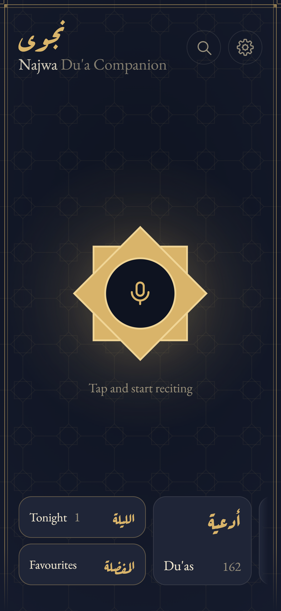
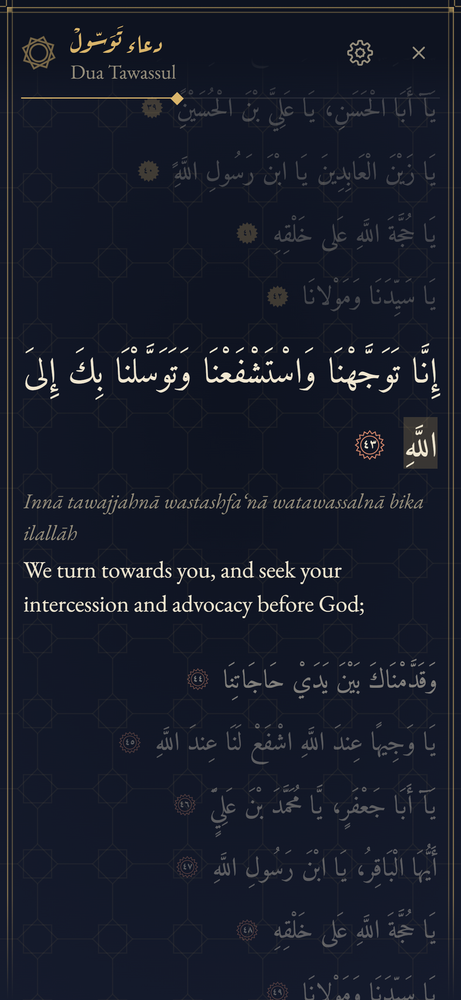
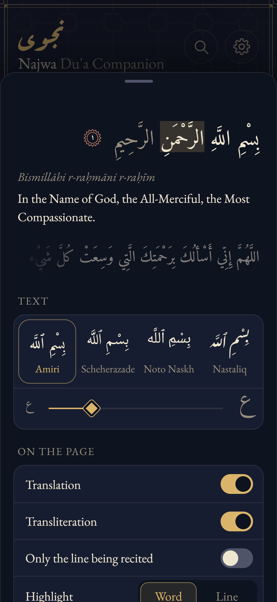
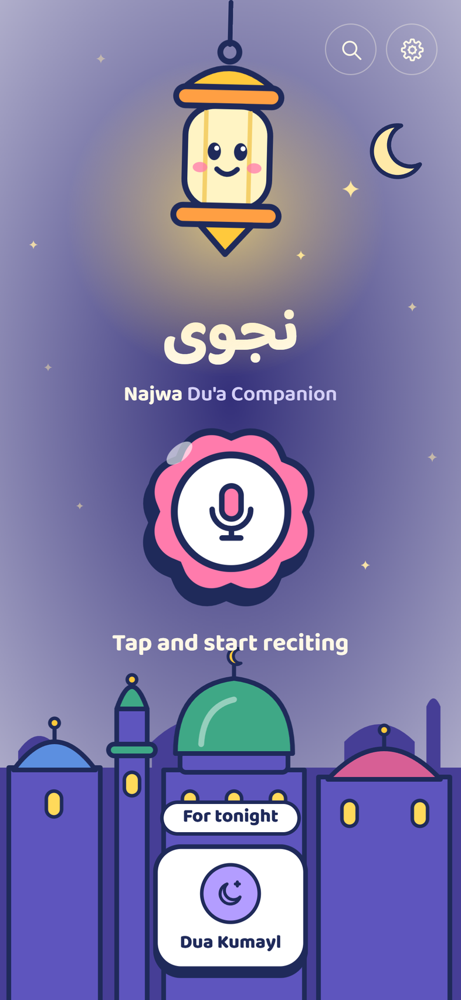
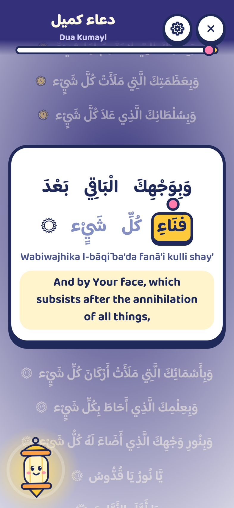
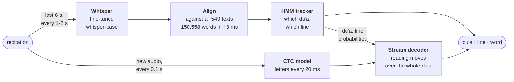

<h1 align="center">Najwa نجوى</h1>

  <b>Recognizes which du'a is being recited and follows it line by line and word by word, live, on a phone.</b> 
  Both speech models run on the phone, so the recitation never leaves it.

  
   Dua Tawassul recited by Hussein Ghareeb (<a href="https://www.duaplayer.org">DuaPlayer</a>), a voice held out of training, through the real page at a phone's speed. Gold: the last 6 s Whisper read and what it heard; it names the du'a. White: the tenth of a second the letter model hears at each step, inside the 3 s it remembers, and the letters it heard; they move the highlight.

  
  
  
  
  

  <a href="https://hasan-mehdi.github.io/najwa/media/explainer.mp4"><b>Watch the narrated explainer</b></a> (7:58) ·
  <a href="CHANGELOG.md">Changelog</a>

## What it does

- **Names the du'a** from anywhere in a recitation: 549 du'as, ziyarat, munajat, the surahs of the
  a'mal, a ruqyah and the adhan; 94% of the time within 10 s of the first words no other text shares
- **Follows the line and the word**, with Arabic, transliteration and English side by side
- **Keeps up with real reading:** pauses, repeated lines, going back, skipping, talk or a salawat
  between lines
- **Practice mode:** checks a reading line by line and marks the lines left out; the text can stay
  hidden until you say it
- **Private:** both models run in the phone's browser, or natively in the Android app, so no audio
  leaves the phone
- **Majlis mode:** one phone drives other phones or a projector through a QR code
- **Easy to read:** four Arabic typefaces, text size, word or line highlighting, favourites, a kids mode

## Results

A scenario bench plays voices held out of training through 24 ways people read (pauses, repeats,
going back, talk between lines, a big hall, a distant phone…) and scores what the page shows. Test
voices, the page as of 2026-10-07, at a phone's real pace (Whisper every 2 s and shown 1.8 s late,
as on a Galaxy Z Flip 6): 617 items, 22 h, 55 voices.

| voices | on the line | on the word | du'a named ≤10 s\* | jumps per 10 min | wrong du'a shown |
|---|---:|---:|---:|---:|---:|
| studio reciters | 89% | 78% | 99% | 1.33 | 0.5% |
| du'a nights (crowd, PA echo) | 90% | 72% | 100% | 3.46 | 2.2% |
| uploaded recitations | 89% | 71% | 91% | 2.13 | 0.9% |
| Mafatih texts | 93% | 80% | 93% | 0.48 | 0.0% |
| **all** | **91%** | **76%** | **94%** | **1.49** | **0.6%** |
| server engine, all | 94% | 83% | 99% | 1.70 | 0.5% |

\* Timed from the first words no other text shares. From the start of reading it's 90% (studio 75%):
many du'as open with words other texts have too.

- **Read straight through:** 94% on the line, 81% on the word, 0.15 jumps per 10 minutes.
- **Weakest:** a phone far from the reader (85% on the line), a big hall (88%), readers who jump
  around the du'a (76%), and du'as the app doesn't have, which are shown as one it does about a
  third of the time.
- **An ordinary reader** (35 stretches of my own reading, 34 minutes, at the phone's pace): 73% on
  the line and 52% on the word. The letter model hears a reader at speaking pace, saying some letters
  the way many non-Arab readers do, far worse than a reciter.
- **Practice mode:** catches 91% of lines left out and every forgotten ending; marks 0.13 read
  lines per 10 minutes as left out.

## How it works

- **Whisper finds the du'a.** Its transcript is matched against every word of every text, and an
  HMM tracker turns the matches and the reader's pace into a probability for each du'a and line.
- **Letters place the word.** A small streaming CTC model hears letters as they are said, and a
  decoder follows them through the du'a, allowing for going back, repeating, skipping and stopping
  to talk.
- **Both run on the phone.** A Whisper-base distilled from a larger server model, and a CTC student
  distilled from wav2vec2 that encodes only the new audio at each step. The server engine is the
  same page with larger models on a server.

## Built with

Python and PyTorch for training and evaluation · Whisper and wav2vec2, fine-tuned and distilled ·
ONNX Runtime Web, Transformers.js and WebGPU in the browser · Kotlin and ONNX Runtime on Android ·
FastAPI for the server engine and majlis rooms · Numba for the alignment and decoders · ManimGL for
the explainer

## Status

In active development. The source is private; this repository shows the project and its
[changelog](CHANGELOG.md), one line for every commit to the source, with its date.

## Acknowledgements

| | |
|---|---|
| **Texts and recordings** | [DuaPlayer](https://www.duaplayer.org), a non-profit, and its reciters, whose hand-timed recordings make evaluation possible · [duas.org](https://www.duas.org) · [duas.pro](https://duas.pro) ([open API](https://github.com/duas-pro/shia-duas-api)) |
| **Models** | [Whisper](https://github.com/openai/whisper) · [tarteel-ai/whisper-base-ar-quran](https://huggingface.co/tarteel-ai/whisper-base-ar-quran) · [wav2vec2-large-xlsr-53-arabic-quran](https://huggingface.co/rabah2026/wav2vec2-large-xlsr-53-arabic-quran-v_final) · [Silero VAD](https://github.com/snakers4/silero-vad) · [OmniVoice](https://huggingface.co/k2-fsa/OmniVoice), for synthetic voices and the explainer's narration |
| **Runtimes** | [faster-whisper](https://github.com/SYSTRAN/faster-whisper) and [CTranslate2](https://github.com/OpenNMT/CTranslate2) · [Transformers.js](https://github.com/huggingface/transformers.js) · [ONNX Runtime](https://onnxruntime.ai) |
| **Evaluation** | [RetaSy's Quranic audio dataset](https://huggingface.co/datasets/RetaSy/quranic_audio_dataset), for everyday voices |
| **Design** | [ManimGL](https://github.com/3b1b/manim) · Amiri, Aref Ruqaa, Scheherazade New, Noto and EB Garamond typefaces |

## Copyright

© 2026 Hasan Mehdi. All rights reserved. The du'a texts, translations and recordings belong to
their sources above.
